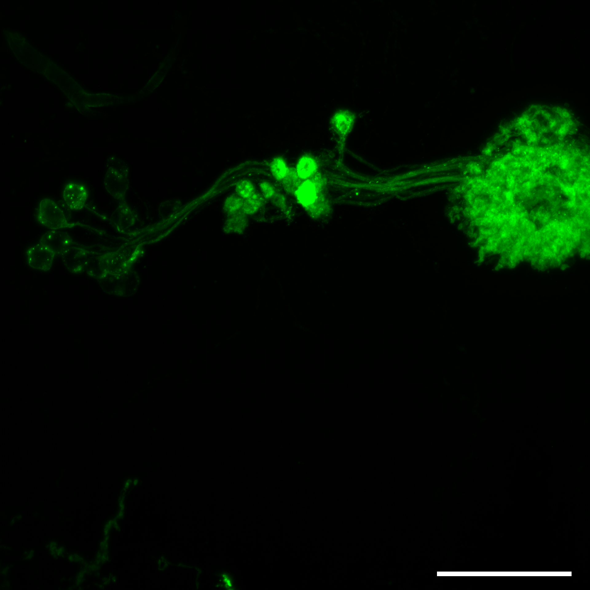
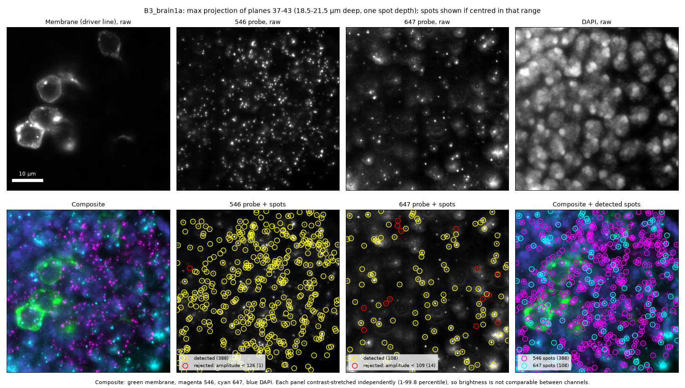
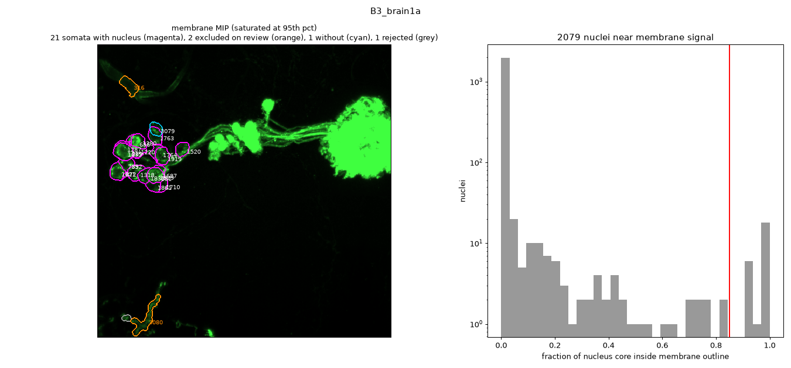
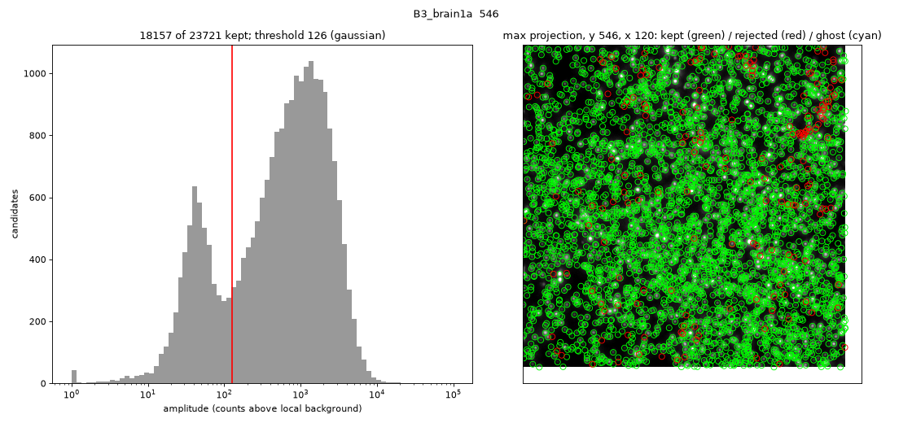
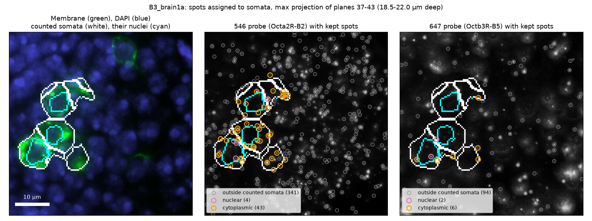
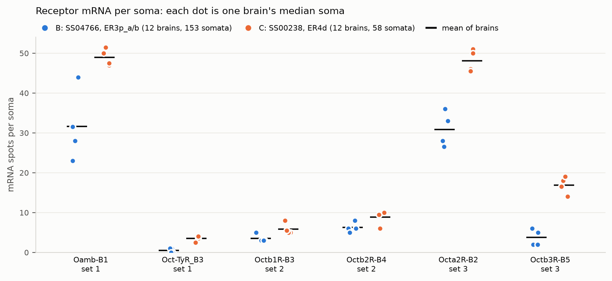
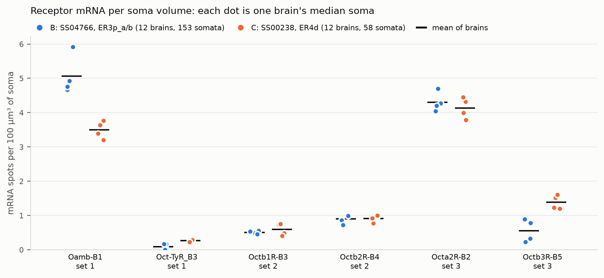

# EASI-FISH-Analysis

## Overview
Analysis of [EASI-FISH](https://www.cell.com/cell/fulltext/S0092-8674(21)01339-8) data of octopamine receptor-related mRNAs in the ring neurons of the *Drosophila* central complex. The pipeline takes in a raw imaging stack with a membrane tag, DAPI stain, and two different tagged RNAs and outputs the RNA counts per soma.

## Data naming convention

| Label | Line name | Neuron type |
|-------|-----------|-------------|
| A     | SS67611   | ER3p_a/b    |
| B     | SS04766   | ER3p_a/b    |
| C     | SS00238   | ER4d        |
| D     | SS17020   | ER1_a       |

Line D is left out of the whole pipeline (`exclude_lines` in `config/config.yaml`): on QC review it did not label the neurons of interest.
Line A is left out of the soma counts (`exclude_soma_lines`): its DAPI stain failed, so its labelled somata have no nuclei to segment. Its neuron type, ER3p_a/b, is also labelled by line B. Line A's neurite measurements are kept.

| Label | receptor 1, 546 nm | receptor 2, 647 nm |
|-------|--------------------|--------------------|
| 1     | Oamb-B1            | Oct-TyR_B3         |
| 2     | Oct $\beta$ 1R-B3  | Oct $\beta$ 2R-B4  |
| 3     | Oct $\alpha$ 2R-B2 | Oct $\beta$ 3R-B5  |

The data consists of czi files with the naming convention {letter}{number}_brain{sample_number}{view}.
The letter corresponds to the genetic line used, as outlined in the first table above.
The number corresponds to the subset of receptors-related mRNAs tagged, as outlined in the second table above.
The view can be blank, a, or b, depending on how many different configurations were used to image the brain.

## Data structure

Each czi file has four color channels, recorded in a z stack throughout the brain.
The green channel is a membrane tag for neurons in the given genetic line.
The 546 and 647 nm channels are the mRNA probes, as described in the second table in the *Data naming convention* section.
The fourth channel is DAPI staining.

A maximum intensity projection of the membrane channel shows the field of view: the labelled somata (left), their neurites running as a bundle to the right, and the neuropil they innervate (right). Scale bar 50 µm.

The four channels in one 3 µm slab through the somata (top row, raw). The bottom row shows the composite and the spots kept (yellow) and dropped (red) by the amplitude filter of step 2. Each panel is contrast-stretched on its own.

## Analysis approach
1. Determine which voxels map to the neuron of interest. The membrane channel is thresholded (globally, and relative to the brightest membrane nearby, to cut out-of-focus glow), filled, and stripped of neurites by a morphological opening. [Cellpose](https://github.com/MouseLand/cellpose) segments nuclei in DAPI, and a nucleus whose core lies inside the filled membrane belongs to a labelled neuron; each soma is the filled membrane nearest its nucleus. Only somata with a nucleus are counted. Soma-sized filled objects without a nucleus are kept in `cells.csv` with `has_nucleus = False` for inspection (if thick and evenly filled with membrane signal), but are left out of `results/tables/spot_counts.csv`: on visual review of 6 samples, 4 of 14 were somata and the rest were dendrites, axons, trachea or fat globules. Somata with a nucleus that review showed are not neurons are listed under `exclude_cells` in `config/config.yaml` and dropped from the same table; the calls behind them are in `results/figures/segmentation/qc_review.csv`. Line A is left out of the soma counts (`exclude_soma_lines`): its DAPI stain failed, with no nuclei in the labelled somata of any brain checked. Its neuron type, ER3p_a/b, is also labelled by line B. Line A's neurite measurements are kept. Per-sample QC figures are written to `results/figures/segmentation/`. In the example below, counted somata are magenta, cells excluded on review orange (here a trachea), nucleus-free cells cyan and rejected outline pieces grey; the histogram shows how much of each nucleus's core lies inside the membrane outline.

   
2. Localize the mRNAs. [Spotiflow](https://github.com/weigertlab/spotiflow)'s pretrained 3D smFISH model proposes puncta, and candidates whose peak above the local background is below a per-sample threshold are dropped. Imaging conditions differ between brains, so the threshold is set for each sample and channel where its amplitude histogram leaves the noise peak: the noise is modelled as a Gaussian fitted to the left half of that peak, and the threshold is where it falls below 10% of the candidates. Puncta often form only a shoulder on the noise peak, so a valley between the two cannot be relied on (`spot_filter` in `config/config.yaml`, where it can be overridden). In 647, a bright punctum's out-of-focus cone produces a dimmer ghost detection 2–4 µm above it; kept 647 spots with a brighter kept spot directly below at that offset are dropped (about 11% of C1's and 4% of B3's 647 spots). Spotiflow was chosen over a Laplacian-of-Gaussian detector (Big-FISH) because it ignores the defocus rings around bright puncta, which Big-FISH picks up. RS-FISH was not benchmarked. The four C2 546 channels have a broad noise peak that merges with the puncta, so their thresholds were set by eye to 150 from galleries of candidates. Per-sample QC plots are written to `results/figures/spots/`: the amplitude histogram with the threshold (left; here a clear noise peak near 40 and puncta near 1000), and kept and rejected spots in the densest region (right).

   
3. Colocalize the mRNAs with the neuron voxels to determine how many mRNAs are in each cell type. Each spot in a soma is tagged nuclear or cytoplasmic, or unknown in a soma without a detected nucleus. Neurites are measured separately, as one compartment per sample: a full-resolution membrane mask minus the counted somata (with a nucleus) gives the spot density in the line's processes, compared with the density in a 1–3 µm shell of surrounding tissue (`results/tables/neurite_counts.csv`, QC in `results/figures/neurites/`). Membrane within 2 µm of any DAPI nucleus is left out of both, since neuropil has no cell bodies: this keeps dim somata the segmentation misses out of the neurite count, at the cost of the first micron or two of each primary neurite. Enrichment near 1 means the neurites hold no more spots than the neuropil they run through. Neurite QC figures are in `results/figures/neurites/`.

   The example below shows spots assigned to somata in the same region as the raw-data example: counted somata are outlined in white and their nuclei in cyan (in the middle plane of the 3 µm slab), and each kept spot is marked nuclear (pink), cytoplasmic (orange) or outside any counted soma (grey). Spots are drawn from all planes of the slab, so a few assigned spots sit just outside the outline drawn from the middle plane. Drawn by `snakemake results/figures/<sample>_soma_example.png`, for the region set under `example_plane` in `config/config.yaml`.

   

## Results

Soma counts come from 211 somata with a nucleus in 24 brains: 153 in 12 line B brains (ER3p_a/b) and 58 in 12 line C brains (ER4d). Line A is left out for its failed DAPI stain and line D for not labelling the neurons of interest. Each dot is one brain, summarised by its median soma so that brains with many somata do not dominate; the line is the mean of the brains. Tables: `results/tables/spot_counts.csv` (one row per soma and channel) and `results/tables/neurite_counts.csv`.

Spots per soma:

ER4d somata are larger than ER3p_a/b somata (median 1162 vs 668 µm³), so raw counts are higher in ER4d for every receptor. Normalised by soma volume:

- Oamb and Octα2R are the most abundant in both neuron types (3.5–5.1 spots per 100 µm³).
- Octβ3R is the one receptor clearly denser in ER4d (1.4 vs 0.6 per 100 µm³); Oamb is somewhat denser in ER3p_a/b (5.1 vs 3.5).
- Octβ1R, Octβ2R and Octα2R are at similar densities in both; Oct-TyR is near zero in both.
- Brains agree closely, so these differences are consistent across samples.

Neurite enrichments are not summarised yet: a few brains have very high values (up to 50), probably from very small neurite masks or near-empty shells, and need checking first.
## Inspecting results
- `snakemake data/processed/<sample>/inspect` writes Fiji hyperstacks for one sample: the whole field on the segmentation grid, and full-resolution crops (with PNGs) of each nucleus-free cell. Channels are membrane, DAPI, each probe, soma and nucleus labels, soma outlines, and kept and rejected spot candidates per probe. It runs spot detection for the sample if needed.
- `snakemake results/figures/<sample>_example_plane.png` draws the example figure (raw channels with detected and rejected spots in one region); the region is set under `example_plane` in `config/config.yaml`.
